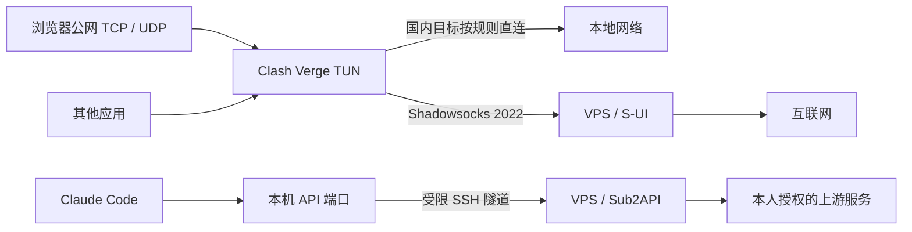

# Cloud Stack Kit

[](https://github.com/BaoJun-UCAS/cloud-stack-kit/actions/workflows/ci.yml)
[](LICENSE)

将一台专用 Ubuntu VPS 与电脑连接起来：部署 **S-UI + Shadowsocks 2022 + Sub2API**，配置 **Clash Verge Rev 分流、UDP/TUN、SSH 隧道、登录后自启动和 Claude Code API 启动器**。服务器首次部署以 Windows 为入口；已有服务器支持 **Windows / macOS 朋友一键接入**。

这是可审查、可分步执行的部署脚本。服务器地址和本机设置通过配置文件填写，密码与密钥在部署时生成，不随仓库分发。

> 已通过脚本检查、单元测试与配置校验；尚未在全新 Windows + 全新 Ubuntu 上完整验收，arm64 也未实装。首次使用请按阶段执行，完整记录见 [验证记录](验证记录.txt)。

## 部署后的连接



默认浏览器公网流量全部通过 VPS，其他应用访问国内目标直连；浏览器局域网访问保留。`policy.browserMode: "split"` 可改为浏览器国内 TCP 直连、UDP 走代理。

管理面板与 API 仅监听服务器回环地址，通过 SSH 转发访问。普通代理流量使用 Shadowsocks，不经过 SSH。

## 准备条件

- Windows 10/11、Windows PowerShell 5.1 或 PowerShell 7、OpenSSH 客户端、Node.js 22.13+；建议使用仍受支持的 Windows 与 Node.js LTS。
- Clash Verge Rev **2.4.7**，脚本可通过 winget 安装锁定版本。
- 一台专用 **Ubuntu 24.04 / 26.04** VPS，固定公网 IPv4，root SSH 可登录；支持 amd64 / arm64 资产，建议至少 1 GB 内存、10 GB 可用磁盘。
- 云平台安全组允许 SSH（默认 TCP 22）及代理（默认 TCP/UDP 24443）。
- 能下载 GitHub、npm 和系统软件源；工具不提供公共代理或上游账号。

已存在其他 S-UI / Sub2API 安装的主机，请先看 [迁移与完整说明](使用说明.txt)，不要直接执行 `Server` 或 `All`。

## 快速开始

**只想让朋友共用已经部署的服务器？** 无需重新部署：管理员运行 `Create-Guest.cmd`（Mac：`Create-Guest.command`）生成独立受限凭据；朋友运行 `Join-Windows.cmd` 或 `Join-Mac.command`，输入邀请凭据文件路径即可。每位朋友有独立代理密钥、API Key 和上游分组，详见 [朋友接入、重启与撤销说明](docs/guest.md)。朋友自己的上游账号需要本人授权后由管理员加入对应分组。

从 [Releases](https://github.com/BaoJun-UCAS/cloud-stack-kit/releases) 下载工具包并核对 SHA256，或用 Git 克隆；在项目目录打开 PowerShell。

```powershell
git clone https://github.com/BaoJun-UCAS/cloud-stack-kit.git
cd cloud-stack-kit
```

### 0. 按需清理旧账号本地记录

如果电脑曾登录已停用或被封禁的 Claude 账号，并且不再需要它的本地登录和会话数据，建议在部署前先运行根目录的 **`Cleanup-Claude.cmd`**。查看范围、保存工作并关闭相关应用后，输入 `CLEAN` 执行。已有正常配置且无清理需求可跳过。

工具需要 Node.js **22.13+**，覆盖常见浏览器、Claude 桌面端、Claude Code 和 VS Code 系列编辑器的已知存储位置。**它无法区分旧账号和新账号，会清除范围内的当前登录与本地历史**；不会自动随部署执行。其他网站的共享浏览器缓存也会清空，但 Cookie、密码和书签保留。

清理不会删除服务端记录或解除封禁，也不能保证账号无法关联。自定义配置、云同步、共享 SSO 等仍需本人核对。使用前请阅读 [清理范围、不可恢复的数据与手动检查项](docs/cleanup.md)。

### 1. 填写配置

```powershell
powershell -NoProfile -ExecutionPolicy Bypass -File .\Setup.ps1 -Phase Init
notepad .\config.json
```

至少修改 `instanceId` 和 `server.address`。示例地址 `203.0.113.10` 不能用于部署。

| 字段 | 作用 |
| --- | --- |
| `instanceId` | 实例标识，小写字母、数字、连字符；不同服务器使用不同 ID |
| `server.address` | VPS 真实公网 IPv4 |
| `server.sshPort` | 现有 SSH 端口，脚本不会修改 sshd 端口 |
| `local.clashExe` | 留空自动查找，或填写 Clash 可执行文件完整路径 |
| `policy.browserMode` | `proxy` 为浏览器公网全代理，`split` 为浏览器国内 TCP 直连 |
| `region.enabled` | 是否在激活时设置 Windows 时区、区域和格式；不需要则设为 `false` |
| `region.*` | 默认美国洛杉矶，须按实际需要修改，不会自动定位服务器 |
| `bootstrapProxy` | npm 初次下载使用的已有代理地址，可留空，不允许嵌入凭据 |

不要把服务器密码、API Key 或私钥写入 `config.json`。

### 2. 检查依赖，部署服务器

```powershell
powershell -NoProfile -ExecutionPolicy Bypass -File .\Setup.ps1 -Phase Validate -InstallDependencies
powershell -NoProfile -ExecutionPolicy Bypass -File .\Setup.ps1 -Phase Server
```

首次 SSH 请通过云平台控制台核对主机指纹，再输入初始密码。如果已有管理私钥，可加 `-ExistingAdminKey "X:\secure\admin_key"`。

脚本会生成本机专用管理密钥与受限隧道密钥；确认新密钥登录成功后关闭 SSH 密码认证。请加密备份 `%LOCALAPPDATA%\CloudStack\<instanceId>\admin_key`。

### 3. 准备本机，再启用代理

```powershell
powershell -NoProfile -ExecutionPolicy Bypass -File .\Setup.ps1 -Phase Windows -InstallDependencies
```

准备完成后，在**同一 Windows 用户的管理员 PowerShell** 执行：

```powershell
powershell -NoProfile -ExecutionPolicy Bypass -File .\Setup.ps1 -Phase Activate
```

`Activate` 会备份配置、安装或启动 Clash 服务、切换 TUN 和系统代理，并验证出口；失败时尝试回退。这一步可能短暂重连。独立辅助代理供恢复使用，无法承诺切换时零中断。

### 4. 配置 API 上游

打开 `%LOCALAPPDATA%\CloudStack\<instanceId>\Panel.lnk`，登录信息在同目录 `panel-login.txt`。管理员本人阅读面板要求并完成确认，然后执行：

```powershell
powershell -NoProfile -ExecutionPolicy Bypass -File .\Setup.ps1 -Phase Gateway
powershell -NoProfile -ExecutionPolicy Bypass -File .\Setup.ps1 -Phase Check
```

在面板中添加本人获准使用的上游账号或凭据。脚本只创建本地调用所需的下游 API Key，不代为登录上游账号。

从 [官方渠道安装 Claude Code](https://code.claude.com/docs/en/setup)，再打开实例目录的 `Claude.lnk`。如需指定工作目录，在项目终端使用：

```powershell
$state = Join-Path $env:LOCALAPPDATA 'CloudStack\my-us-vps' # 改成你的实例 ID
powershell -NoProfile -ExecutionPolicy Bypass -File "$state\Launch.ps1" -StateDir $state -Mode Claude
```

`Check` 不调用收费模型。完成授权后，请实际发送一次模型请求，再确认上游链路可用。Pro/Max 订阅是否可用于第三方网关取决于上游规则，技术连通不能代替账号使用许可。

## 重启、迁移与恢复

- [重启后如何启动、检查及恢复](docs/restart.md)
- [部署前一键清理旧 Claude 本地数据](docs/cleanup.md)
- [新电脑接入旧服务器、换服务器、完整阶段说明](使用说明.txt)
- [可选 Windows 首选语言和更新控制](docs/windows-options.md)
- [排错与网络检测结果解释](docs/troubleshooting.md)
- [安全边界、凭据和备份](SECURITY.md)

默认在 **Windows 用户登录后** 自动启动；服务器服务由 systemd 开机启动。语言调整和关闭 Windows 更新属于独立可选操作，部署流程不会执行它们。

## 开发与验证

```powershell
npm ci --ignore-scripts --no-audit --no-fund
npm test
npm run check:public
powershell -NoProfile -ExecutionPolicy Bypass -File .\Validate-Kit.ps1
powershell -NoProfile -ExecutionPolicy Bypass -File .\Build-Package.ps1
```

Linux 上验证服务端：

```bash
python3 -W error::ResourceWarning -m unittest discover -s tests -p test_server.py -v
bash -n server/bootstrap.sh
```

GitHub Actions 分别运行 Linux 测试、Windows PowerShell 检查和 ZIP 构建。不会连接生产服务器、启用 TUN 或修改 Windows 更新。发布包仅从 `package-files.json` 的明确清单生成，并附 SHA256 与逐文件清单。

目录：`server/` 为 VPS 部署，`windows/` 为本地运行工具，`lib/` 为配置和网络检测，`tests/` 为离线测试，`docs/` 为操作说明。

## 许可证与上游

本仓库原创部署脚本使用 [MIT 许可证](LICENSE)。S-UI、Sub2API、Clash Verge Rev、Mihomo、规则库等独立项目仍遵循各自许可证，见 [第三方说明](THIRD_PARTY_NOTICES.md)。仓库不捆绑上游二进制或个人运行数据。

本工具用于管理本人有权使用的网络与 API。它不保证匿名、账号无法关联或避免封禁；代理、时区和语言配置也不会改变服务提供方的使用条件。
